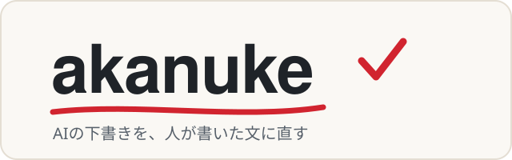

<p align="center">
  
</p>

<p align="center"><a href="./README.md">日本語</a></p>

# akanuke

An agent skill that removes the tell-tale patterns of AI-generated **Japanese business writing**: emails, chat messages, slides, proposals, and sales talk scripts. It is tested with Claude Code and built to load the same way in Codex. It also ships a short paste-in version for ChatGPT, Gemini, and Copilot. The name comes from *akanuke* (垢抜け), "to become polished." It is not meant for technical articles, papers, fiction, or social media posts.

The skill and its references are written in Japanese, because the patterns are specific to Japanese.

## What it fixes

| Medium | Typical AI patterns |
|---|---|
| Slides | Everything crammed onto one slide, "01 / 02 / 03" numbering with divider lines, a thin accent bar left of every heading, the same label repeated in every column, colors with no meaning, long boilerplate disclaimers |
| Email and chat | The request buried at the end, stacked 【】 tags in the subject line, Markdown headings and bold text in an email, piled-up greetings and closings, over-polite forms such as させていただきます, unfilled placeholders such as 〇〇様 |
| Talk scripts | Long written-style sentences, a customer who conveniently agrees, leading questions, a formulaic empathy line followed by a pivot to a case study with 実は ("actually") |
| Sentences | Noun-ending key messages, the 「〜のは、〜。」 build-up, "not A but B", quotation marks used for emphasis, buzzwords, forced lists of three |

## Principles

1. Rewrite using only what the original says. No new facts, numbers, dates, examples, or experiences. Keep 約 ("about"), target vs. actual, request vs. report, proposal vs. consultation, decided vs. undecided, and every condition. When something is missing, ask the writer.
2. No format is banned outright. Numbers and colors are fine when they carry meaning; only meaningless ones are removed, and the space they leave is not filled with new decoration.
3. Standard business courtesies such as お世話になっております stay. Only what the AI piled on top is removed.
4. Fix structure before wording: too much on one slide, a title that does not match the content, a request buried at the end of an email.
5. The scripts list candidates; whether to keep or change each one is decided in context.
6. Do not overcorrect. Staged casualness (正直、, ぶっちゃけ) and invented anecdotes are checked too.

## Install

Claude Code plugin (Claude Code 2.1.275 or later):

```
/plugin install akanuke --marketplace Rei-dotwise/akanuke
```

On older versions:

```
/plugin marketplace add Rei-dotwise/akanuke
/plugin install akanuke@akanuke
```

With `npx skills` or the GitHub CLI (tested with `gh` 2.95.0). Run at the root of your repository to install into `.claude/skills/akanuke`:

```sh
npx skills add Rei-dotwise/akanuke -a claude-code
gh skill install Rei-dotwise/akanuke akanuke --dir .claude/skills
```

For a user-wide install, add `-g` (npx skills) or `--scope user --agent claude-code` (gh); those locations have not been tested. Install it one way only; which copy is loaded when there are two has not been tested.

Manual install (Claude Code or Codex). Existing folders or links are left untouched:

```sh
git clone https://github.com/Rei-dotwise/akanuke.git ~/akanuke

# Claude Code
mkdir -p ~/.claude/skills
d=~/.claude/skills/akanuke
if [ -e "$d" ] || [ -L "$d" ]; then echo "Already exists: $d"; else ln -s ~/akanuke/skills/akanuke "$d"; fi

# Codex (older versions read ~/.codex/skills)
mkdir -p ~/.agents/skills
d=~/.agents/skills/akanuke
if [ -e "$d" ] || [ -L "$d" ]; then echo "Already exists: $d"; else ln -s ~/akanuke/skills/akanuke "$d"; fi
```

Invoke it with `/akanuke` in Claude Code (`/akanuke:akanuke` when installed as a plugin) or `$akanuke` in Codex.

Claude.ai: upload `akanuke.zip` from the [releases](https://github.com/Rei-dotwise/akanuke/releases) page (not yet tested).

Other chat AIs: paste the text in [pocket/akanuke-pocket.md](pocket/akanuke-pocket.md) into the custom instructions.

To use it on every request without naming it, add this line to instructions that load every time: `~/.claude/CLAUDE.md` (Claude Code), `~/.codex/AGENTS.md` (Codex), or your personal or project instructions in Claude.ai:

```
日本語のメール、チャット、資料、スライド、トークスクリプトを書く・直すときは、頼まれなくても akanuke スキルの手順に従う。
```

## Scripts

Both scripts use only the Python 3.9+ standard library.

- `scripts/check.py` lists candidate patterns in .md, .txt, and .pptx files. For .pptx it also counts shapes: thin vertical bars beside text, horizontal dividers, the number of fill colors, and text volume per slide. `--script` adds sentence-length and written-style checks for talk scripts. `--fail-on-warn` exits with 1 when any warning is found, for CI or git hooks.
- `scripts/diff.py` compares the text before and after a rewrite and flags possible changes in meaning: numbers and their ranges, dates, weekdays, times, negation, stance words (request, proposal, decision, estimate, target), and condition words. It counts words across the whole document, so a clean result does not prove the meaning is unchanged.
- Company word lists: put `.akanuke-words/allow.txt` (terms never flagged, such as product names) and `flag.txt` (terms always flagged, optionally `term<TAB>replacement`) in the folder where you run the command or any parent, or pass `--words <folder>`. check.py reads both; diff.py reads only `flag.txt` and flags terms that increased after the rewrite.

## Limitations

The scripts only match fixed patterns. Line breaks, the meaning of colors, and the relationship between figures and text need a visual check. Testing so far covers Claude Code on macOS only. For `npx skills` and `gh skill`, only that the files are installed into a repository folder has been checked.

## License

MIT
