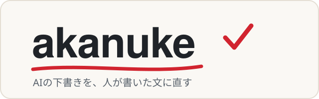

<p align="center">
  
</p>

<p align="center">
  <a href="./LICENSE"></a>
  <a href="https://github.com/Rei-dotwise/akanuke/releases"></a>
  <a href="https://github.com/Rei-dotwise/akanuke/actions/workflows/test.yml"></a>
</p>

<p align="center"><a href="./README.en.md">English</a></p>

# akanuke（あかぬけ）

## これは何？

メール、資料、スライド、トークスクリプトのように、ビジネス職が毎日書く日本語から、AIが作ったと一目で分かる型や飾りを抜くスキルです。ChatGPT、Gemini、Claude などの出力を手直しして使うときにも働きます。Claude Code で確かめていて、Codex でも同じ手順で読み込める作りです。スキルを読み込めないAIには、指示欄に貼る版もあります。名前は「垢抜け」から取りました。

```
直す前  AI導入の成否を分けるのは、現場の納得感。
直した後 AIの導入がうまくいくかは、現場が納得しているかで決まる
```

## 誰のためのものか

AIの下書きを、送る前に毎回自分で手直ししている人に向けています。営業、企画、カスタマーサクセス、管理部門のように、毎日メールと資料を書く仕事です。文章の専門家でなくても、読み手にAIの下書きだと気づかれない文面で送れることを目指しています。

技術記事、論文、小説、SNS投稿は対象にしていません。

## 背景

AIに作らせたスライドに赤を入れていると、毎回同じところで手が止まりました。見出しの左に同じ縦線が付き、ステップに「01」の番号が振られています。3列すべてに「リスク」「ご判断いただきたい点」のラベルが並び、下には3行の定型の免責注釈がありました。キーメッセージは「AI導入の成否を分けるのは、現場の納得感。」のような溜めと体言止めで締めています。

メールも同じでした。AIの下書きには見出しと太字が付き、「させていただきます」が続き、締めの挨拶が三つ重なります。商談の台本では、相手のせりふまでAIが書き、都合よく「まさにその通りです」と答えさせていました。

AIにセルフレビューを頼んでも、ここはほとんど指摘されません。そこで、赤入れで繰り返し出てきたパターンをチェックリストにし、機械で候補を出すスクリプトと、直す前と後で意味が変わっていないかを比べるスクリプトを付けました。

## 大事にしていること

1. 元の内容だけで直す。元の文にない事実、数字、日時、事例、体験を足しません。数値の「約」、目標か実績か、依頼か報告か、提案か相談か、決定か未決か、元の条件も変えません。足りなければ書き手に聞きます。
2. 型そのものは禁止しない。番号にも色にも、意味があれば使って構いません。意味がないのに置かれている型を抜きます。消して空いた場所を、別の飾りで埋めません。
3. ビジネスの定型は残す。「お世話になっております」「ご確認のほど、よろしくお願いいたします」のように、相手も使う挨拶は抜きません。AIが定型に上乗せした分だけを抜きます。
4. 書く前の設計から直す。細かい言い回しより先に、1枚に詰め込みすぎていないか、タイトルと中身が合っているか、用件が後ろにないかを見ます。
5. 機械は候補を出し、残すか直すかは文脈で決める。検出は候補の提示です。回数の目安（体言止めは1〜2か所など）は見直すきっかけで、残すか直すかは読み手への影響で決めます。
6. 直しすぎない。「正直、」「ぶっちゃけ」で演出した口調や、作った失敗談のような、AIっぽさを抜いた後に出やすい型も点検します。

## どう変わるか

### メール

直す前:

```
件名：【ご確認のお願い】【重要】次回お打ち合わせ日程のご調整につきまして
（中略）
さて、本日は次回のお打ち合わせ日程についてご相談させていただきたく、ご連絡させていただきました。

## 候補日程
- **12月1日（火）** 10:00〜11:00
（中略）
上記以外でご都合のよろしい日程がございましたら、お気軽にお申し付けください。
ご不明点がございましたら、お気軽にお問い合わせください。

引き続き、何卒よろしくお願い申し上げます。
```

直した後:

```
件名：次回お打ち合わせ日程のご相談
（中略）
次回のお打ち合わせの日程をご相談させてください。
以下の候補で、ご都合のよい日時はありますでしょうか。

12月1日（火）10:00〜11:00
（中略）
上記以外でご都合のよい日時があれば、お知らせください。
引き続きよろしくお願いいたします。
```

件名の【】の重ね、メールの見出しと太字、目的の宣言、「お気軽に」の二文を外しました。名乗りとお礼、候補以外の日でもよいという条件は残しています。

### スライド1枚

直す前は、方針と判断事項と対象範囲を1枚に盛っていました。飾りとして、01・02・03の番号、左の縦線、3色の塗り分け、3行の免責注釈が付き、「リスク」「ご判断いただきたい点」のラベルは各3回並んでいました。直した後は、共有する1枚と決めてもらう1枚に分け、繰り返していたラベルは表の列見出しとして1回だけ置いています。

```
[2枚目] 以下の3点をご判断ください

                  決めること                    この段階で起きやすいこと
  1 業務の棚卸し    全社で始めるか、一部門で始めるか      棚卸し自体が目的になる
  2 試行           どの指標を使い、効果をどう測るか      期待と結果がずれる
  3 定着           誰が運用の責任を持つか              特定の担当者に頼りきりになる

  当社は、生産性を約30%高めることを目標として提案します
```

全文と、トークスクリプト、書き手から事情を聞けた場合の直し方、直しすぎた例は [examples.md](skills/akanuke/references/examples.md) にあります。ここに載せた例は説明用に作ったものです。

## インストール

### 1. Claude Code のプラグイン（おすすめ）

Claude Code の中で次を実行します。

```
/plugin install akanuke --marketplace Rei-dotwise/akanuke
```

この1行は Claude Code 2.1.275 以降で使えます（`claude plugin validate` の案内による）。それより前の版では2行に分けます。

```
/plugin marketplace add Rei-dotwise/akanuke
/plugin install akanuke@akanuke
```

### 2. フォルダを置く（Claude Code・Codex）

```sh
git clone https://github.com/Rei-dotwise/akanuke.git ~/akanuke

# Claude Code
mkdir -p ~/.claude/skills
d=~/.claude/skills/akanuke
if [ -e "$d" ] || [ -L "$d" ]; then echo "既にあります: $d"; else ln -s ~/akanuke/skills/akanuke "$d"; fi

# Codex（古い版の Codex は ~/.codex/skills を読みます）
mkdir -p ~/.agents/skills
d=~/.agents/skills/akanuke
if [ -e "$d" ] || [ -L "$d" ]; then echo "既にあります: $d"; else ln -s ~/akanuke/skills/akanuke "$d"; fi
```

同じ名前のフォルダやリンクが既にあるときは、何も変えずに場所を表示します。中身を確かめてから置き換えてください。`skills/akanuke` フォルダを各ツールの skills フォルダへコピーしても動きます。

### 3. Claude.ai に登録する

[リリース](https://github.com/Rei-dotwise/akanuke/releases)の `akanuke.zip` をダウンロードし、Claude.ai の設定にあるスキルの画面から登録します。

### 4. ChatGPT・Gemini・Copilot に貼る

スキルを読み込めないAIには、[akanuke-pocket.md](pocket/akanuke-pocket.md) の約810字の指示文を、カスタム指示や Gem の指示欄に貼ります。型の一覧は要点だけで、スクリプトは使えません。

## 毎回使わせる

スキルは、依頼の内容が説明文に合うと自動で読み込まれます。ただし、読み込むかどうかはAIが判断するので、毎回とは限りません。頼まなくても毎回読み込ませたいときは、次の1行を `~/.claude/CLAUDE.md`（Claude Code）や `~/.codex/AGENTS.md`（Codex）に足してください。これらのファイルは毎回読み込まれます。

```
日本語のメール、チャット、資料、スライド、トークスクリプトを書く・直すときは、頼まれなくても akanuke スキルの手順に従う。
```

ほかの日本語推敲スキルと一緒に使うと、指示が食い違うことがあります。出力が乱れるときは、対象の文書を分けるか、どちらかを止めてください。

## 使い方

名前を出さずに「このメールを書いて」と頼むだけでも、たいていは働きます。明示するときは、Claude Code では `/akanuke`（プラグインで入れた場合は `/akanuke:akanuke`）、Codex では `$akanuke` で呼び出せます。

```
/akanuke このスライドの構成案を直して
$akanuke ChatGPTが書いたこのメール、AIっぽいところを指摘だけして
/akanuke 商談の導入トークを書いて
```

「書く」「直す」「指摘だけ」の三つで動きます。指摘だけを頼むと、本文は書き換えず、箇所・パターン・理由・直し方の案を表で返します。直すときは、まず元の文にある内容だけで直します。体験や数字が足りなければ書き手に聞き、作り足しはしません。

## 付属のスクリプト

どちらも Python 3.9 以上の標準ライブラリだけで動きます。スキルの中では、AIが自分で実行します。

### check.py（型の候補を出す）

.md / .txt / .pptx を読みます。メールでは、【】を重ねた件名、穴埋めの記号の残り、「させていただきます」の連続などを拾います。`--script` を付けると、台本として1文の長さと書き言葉も数えます。pptx では、文の型に加えて、同じラベルの繰り返し、0付き番号、文字の左にある細い縦長の図形、水平の区切り線、塗りの指定の数、小さい文字の長い注釈、1枚の文字量を数えます。スライド番号は表示順です。

[examples.md](skills/akanuke/references/examples.md) の「直す前」のスライドを pptx で再現してかけた結果です。

```
$ python3 skills/akanuke/scripts/check.py deck.pptx
=== deck.pptx: 19件
  空疎な語: 4
  01・02・03の番号と仕切り線: 3
  コロンや【】で区切る見出し: 2
  強調のためのカギカッコ: 2
  同じラベルを繰り返す: 2
  「〜ではなく〜」: 1
  長い免責注釈: 1
  左の縦線（アクセントバー）: 1
  仕切り線で区切って関係をぼかす: 1
  意味のない色分け: 1
  1枚に全部盛る: 1
[警告] スライド1 コロンや【】で区切る見出し … ラベルで見出しを作っている
    論点4：生成AI活用の推進方針とご判断事項
[警告] スライド1 「〜ではなく〜」 … 誰も主張していない誤解を否定していないか
    【基本方針】AIは人の「代替」ではなく、社員の可能性を引き出す「伴走者」として位置づける
（以下、候補ごとの行が続く）
```

### diff.py（直す前と後で意味が変わっていないかを比べる）

.md / .txt を読みます。数値と「約」などの幅、日付・曜日・時刻、否定の数、文の立場（依頼、提案、相談、決定、見込み、目標、義務）、条件と時期の語（以外、場合、のみ、次回など）の変化を挙げます。意味が変わった恐れがあるものを「恐れ」、言い方や回数だけが変わったものを「情報」として出します。`--year` を付けると、曜日が暦と合っているかも確かめます。`--fail-on-risk` を付けると、恐れがあるときに終了コード1を返します。

日程と目標の3行を、わざと意味を変えて直した例です。

```
$ python3 skills/akanuke/scripts/diff.py --year 2026 before.txt after.txt
=== before.txt → after.txt: 意味が変わる恐れ 5件、言い方の入れ替え 0件
[恐れ] 数値の幅 … 「約」「以上」「程度」などの幅が変わった
    消えた: 約30%
[恐れ] 目標・実績・試算 … 語の数 1 → 0。文の立場が変わっていないか
    消えた: 目標
[恐れ] 条件・範囲 … 元にあった語が消えたか、元にない語が入った。条件や時期が変わっていないか
    消えた: 以外
    増えた: 場合
[恐れ] 曜日 … 2026年の12月2日は水曜日
    増えた: 12月2日（木）
[恐れ] 曜日 … 曜日が変わった
    消えた: 12月2日（水）
    増えた: 12月2日（木）
```

## 対象にするもの

| 媒体 | 主なパターン |
|---|---|
| スライド・資料 | 1枚に全部盛る、01・02の番号と仕切り線、左の縦線、同じラベルの繰り返し、意味のない色分け、矢印でつなぐ因果、根拠のない評価、語の途中での改行、長い免責注釈 |
| メール・チャット | 用件が後ろにある、【】を重ねた件名、メールの見出しと太字、前置きと締めの重ね、「させていただきます」「となっております」の連続、二重敬語、穴埋めの記号の残り |
| トークスクリプト | 長い一文、声に出すと硬い書き言葉、相手が都合よく納得するせりふ、誘導の問い、共感の定型と「実は」から事例へつなぐ切り返し、ト書きの多用 |
| 文と言い回し | 体言止めと溜め（「〜のは、〜。」）のキーメッセージ、「〜ではなく〜」、強調のカギカッコ、何が起きるのかを書かない動詞（「刺さる」など）、空疎な語、三つ並べ、「〜につながります」の結び、教授調、出典のない総意、「近年、〜が急速に」の書き出し |
| AIの出力の貼り付け | AIとのやり取りが残る、チャットの書式が残る、書き手に向けた締めが残る、作られた日時や事例 |

## 限界

- 2つのスクリプトは、決まった形を拾うだけです。候補が出なかった箇所も、読んで確かめてください。
- diff.py は文書全体で語を数えて比べ、文どうしの対応は取りません。何も出なくても意味が同じとは限りません。言い換えの多い直しでは、問題のない変化も「恐れ」として出ます。依頼の文が別の箇所にも残っていると、ある文が依頼から報告に変わっても拾えません。
- 改行位置、色の意味、図と文の関係は、資料を画像で見ないと判断できません。
- 確かめたのは macOS の Claude Code です。Codex、Claude.ai（スクリプトが動くかを含む）、Windows での動作と、貼り付け版を使ったときに指示どおりに直るかは、確かめていません。

## リポジトリ構成

```
skills/akanuke/
  SKILL.md                 手順の本体
  references/              パターンの一覧と作例（スライド、メール、トークスクリプト、文）
  scripts/check.py         型の候補を出す
  scripts/diff.py          直す前と後を比べる
pocket/akanuke-pocket.md   指示欄に貼る版
tests/                     テストと、テスト用のファイル
.claude-plugin/            Claude Code のプラグインの設定
```

テストは `cd tests && python3 -m unittest` で実行できます。作例の「直した後」で検出が0件であることと、この README に載せた出力が実際の出力と一致することも確かめています。変更の履歴は [CHANGELOG.md](CHANGELOG.md) にあります。

## 作者

[Dotwise](https://github.com/Rei-dotwise)。営業の現場でのAI活用を支援する個人事業です。

## ライセンス

MIT
